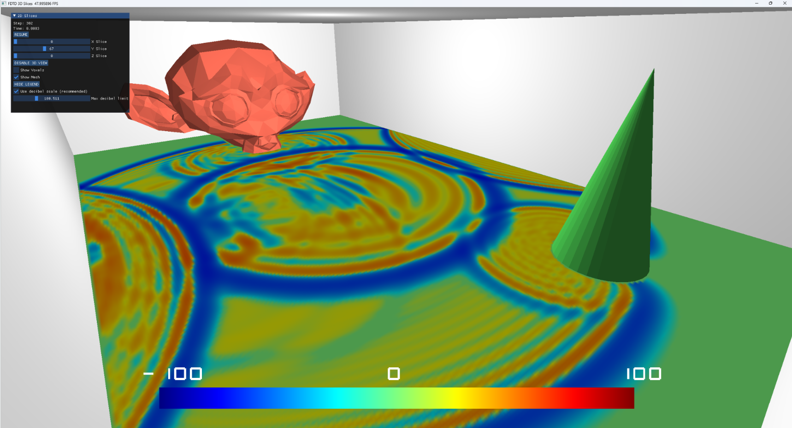
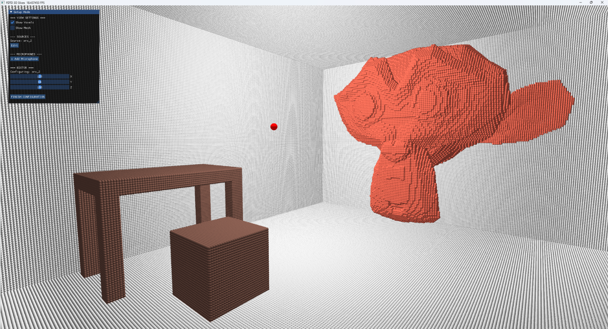
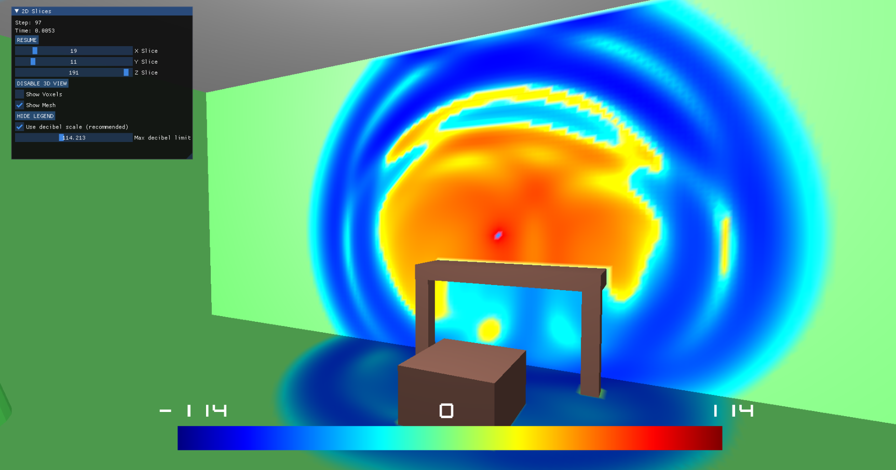

# Acoustic Wave Propagation Simulator (3D FDTD)

<div align="center">
  
  
  
</div>

## Description
This project is a computer application that simulates and visualizes how sound waves travel in a 3D space. It calculates how sound moves by solving the acoustic wave equation using a method called FDTD (Finite Difference Time Domain).

## Technologies Used
* **Python 3.x**: Chosen for its broad support for scientific libraries and ease of development.
* **Taichi Lang**: The core technology powering both the computational engine and result visualization.

## Main Features
* **3D FDTD Engine**: Simulates how sound pressure changes and moves through a 3D space.
* **PML Perfectly Matched Layers**: Uses special layers to simulate open, borderless spaces, and calculates how sound bounces off different materials.
* **Environment Voxelizer**: Takes 3D scenes (.obj files made with Blender) and turns them into a grid of materials with specific physical properties like sound absorption so the engine can process them.
* **Real-time Visualization**: Renders 2D slices of the 3D acoustic field dynamically.
* **Audio I/O Integration**: Support for `.wav` files to allow importing custom source signals and exporting audio "recordings" after the simulation completes.

## Roadmap & Future Works
* **Voxel Optimization**: Further optimization of the voxel processing pipeline to improve memory efficiency and initialization speed.

## Demo

<div align="center">
  
  <p><i>Visualization and GUI (Example 1)</i></p>
</div>

<div align="center">
  
  <p><i>Voxelized 3D environment</i></p>
</div>

<div align="center">
  
  <p><i>Visualization and GUI (Example 2)</i></p>
</div>

## Setup

1. Clone the repository.
2. Install the required dependencies:
```bash
pip install -r requirements.txt
```
3. Run the simulation
```bash
python main.py
```

## License
Distributed under the MIT License.

---

<div align="center">
 <a href="https://github.com/mateushhh">
 
 </a>
 
 <a href="https://github.com/pomiano">
 
 </a>
 
 <a href="https://github.com/maciejblawat">
 
 </a>
</div>
